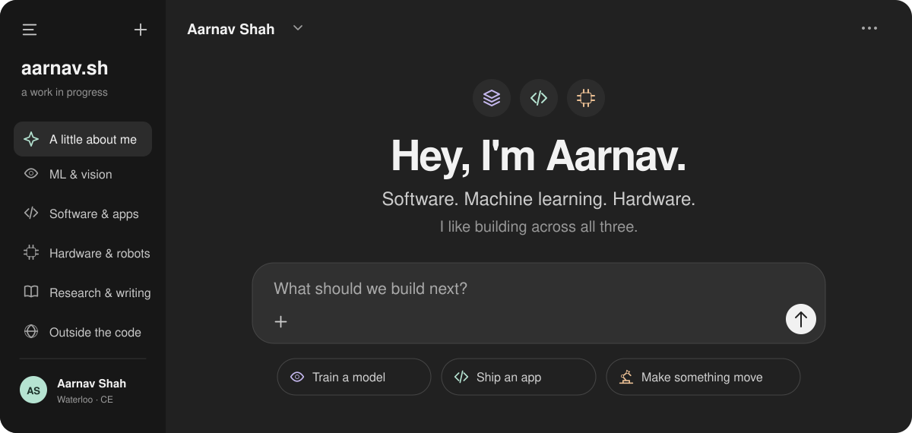
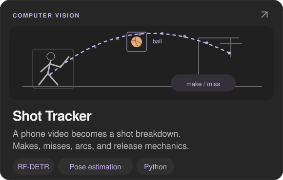
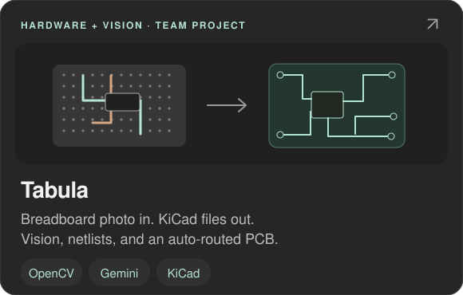
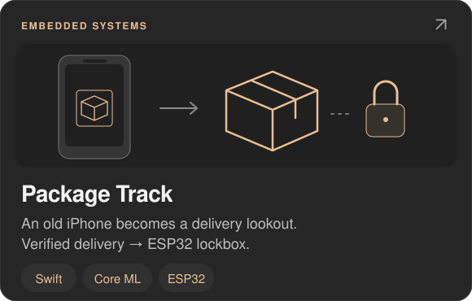
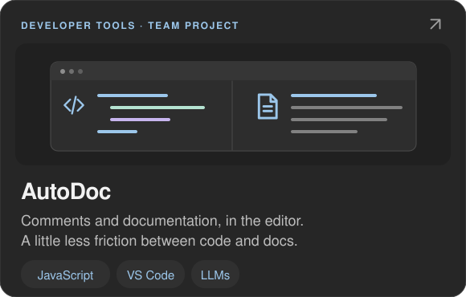
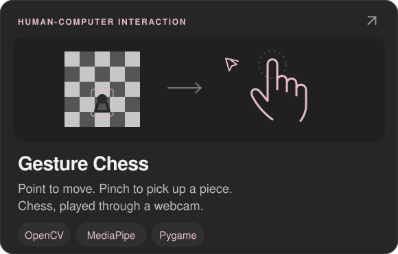
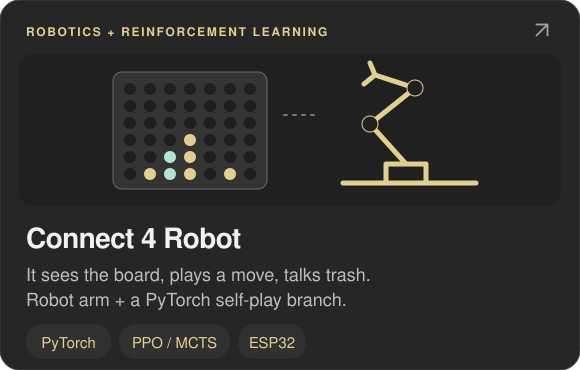
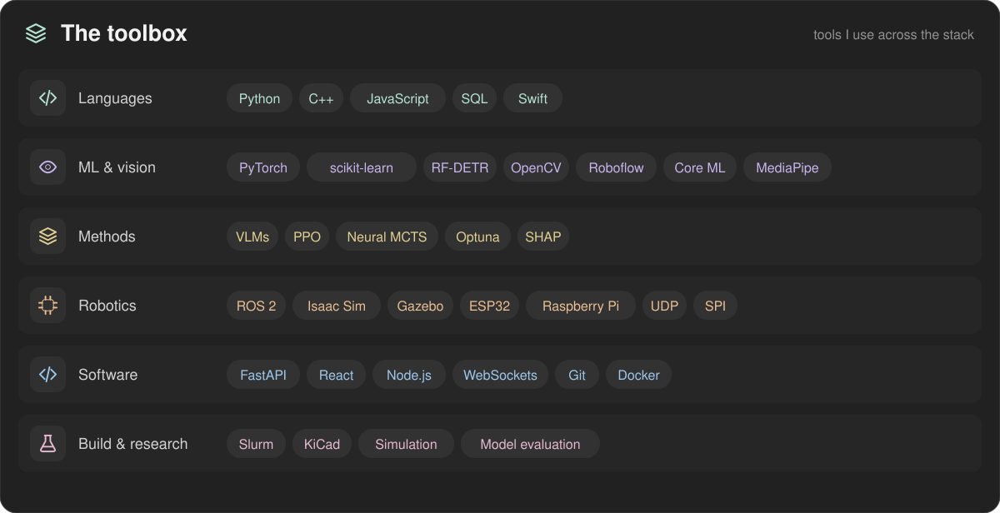
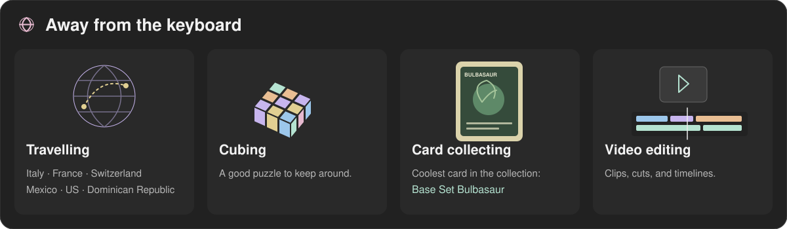

<a href="https://aarnavshah.vercel.app"><b>Explore my website ↗</b></a> &nbsp; · &nbsp;
<a href="https://www.linkedin.com/in/aarnav-shah-a120042b1/">Find me on LinkedIn</a> &nbsp; · &nbsp;
<a href="#a-few-things-ive-built">Browse the projects ↓</a>

I'm a computer engineering student at **Waterloo**. I like the whole build: training the model, writing the app, and getting the hardware to cooperate. My projects tend to cross a few of those lines.

### A few things I've built

<table>
<tr>
<td width="50%"></td>
<td width="50%"></td>
</tr>
<tr>
<td width="50%"></td>
<td width="50%"></td>
</tr>
<tr>
<td width="50%"></td>
<td width="50%"></td>
</tr>
</table>

Click a card for the code and build notes.

### A couple of things to read

**[50+ computer vision guides & demos](https://aarnavshah.vercel.app)** through my work with Roboflow. The code is more useful when someone else can build on it.

**[Redox flow battery ML research](https://papers.ssrn.com/sol3/papers.cfm?abstract_id=7193854)** · Co-author, 2026 preprint. Neural-network surrogates for predicting battery performance from simulation data.
