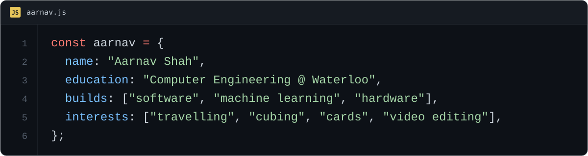
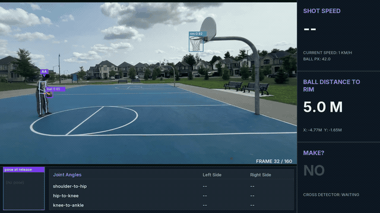
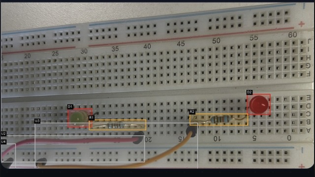
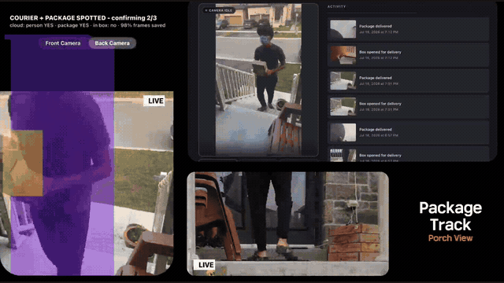
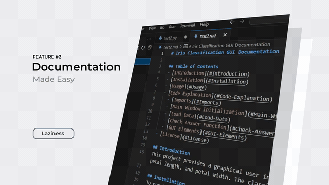
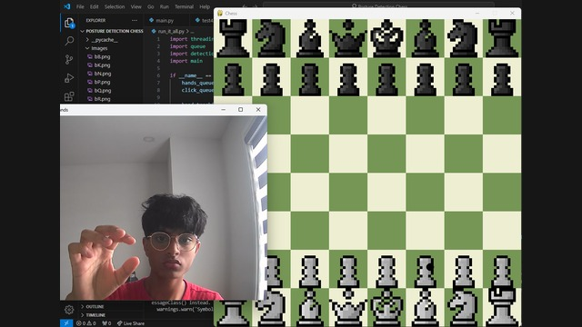
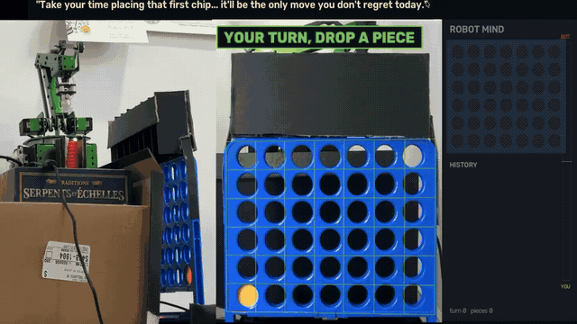
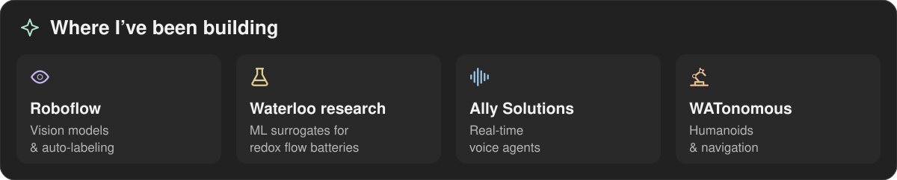

<a href="https://aarnavshah.vercel.app"><b>Website ↗</b></a> &nbsp; · &nbsp;
<a href="https://www.linkedin.com/in/aarnav-shah-a120042b1/">LinkedIn</a> &nbsp; · &nbsp;
<a href="https://aarnavshah.vercel.app/#projects">More projects</a>

I'm a computer engineering student at **Waterloo**. I like the whole build: training the model, writing the app, and getting the hardware to cooperate. My projects tend to cross a few of those lines.

### A few things I've built

<table>
<tr>
<td width="50%" valign="top">

<h3>Shot Tracker</h3>

Recorded basketball clips, broken down shot by shot.

<a href="https://github.com/aarnavshah12/shot-tracker">Code ↗</a> · <a href="https://aarnavshah.vercel.app/assets/videos/shot-tracker.mp4">Full demo ▶</a>

</td>
<td width="50%" valign="top">

<h3>Tabula</h3>

A breadboard photo becomes a KiCad schematic and PCB.

<a href="https://github.com/aarnavshah12/Tabula">Code ↗</a> · team project

</td>
</tr>
<tr>
<td width="50%" valign="top">

<h3>Package Track</h3>

An iPhone camera, verified deliveries, and an ESP32 lockbox.

<a href="https://github.com/aarnavshah12/Package-Track">Code ↗</a> · <a href="https://aarnavshah.vercel.app/assets/videos/package-track.mp4">Full demo ▶</a>

</td>
<td width="50%" valign="top">

<h3>AutoDoc</h3>

Code comments and documentation, straight from VS Code.

<a href="https://github.com/aarnavshah12/AutoDoc">Code ↗</a> · <a href="https://github.com/aarnavshah12/AutoDoc/raw/refs/heads/main/Autodoc%20Teaser.mp4">Full demo ▶</a> · team project

</td>
</tr>
<tr>
<td width="50%" valign="top">

<h3>Gesture Chess</h3>

Webcam hand gestures driving a chess game.

<a href="https://github.com/aarnavshah12/Gesture-Chess">Code ↗</a>

</td>
<td width="50%" valign="top">

<h3>Connect 4 Robot</h3>

Camera-guided gameplay, a robot arm, and a self-play branch.

<a href="https://github.com/aarnavshah12/connect4-robot">Code ↗</a> · <a href="https://aarnavshah.vercel.app/assets/videos/connect4.mp4">Full demo ▶</a>

</td>
</tr>
</table>

The loops are clips from the real demos. Click a preview to open the full video or project.

### A couple of things to read

**[50+ computer vision guides & demos](https://roboflow.com/blog/author/aarnavshah)** through my work with Roboflow. The code is more useful when someone else can build on it.

**[Redox flow battery ML research](https://papers.ssrn.com/sol3/papers.cfm?abstract_id=7193854)** · Co-author, 2026 preprint. Neural-network surrogates for predicting battery performance from simulation data.
